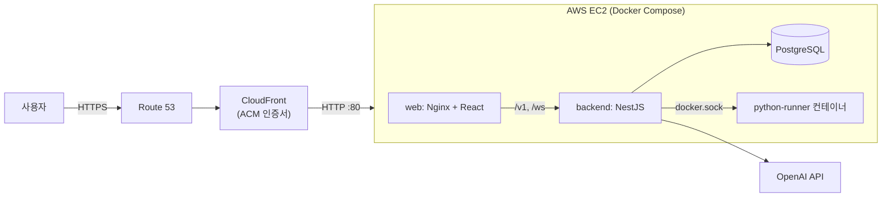

# 배포 가이드 (AWS EC2 단일 호스트)

## 아키텍처



- HTTPS는 CloudFront에서 끝나고(ACM 인증서), CloudFront → EC2 구간은 HTTP(80)다.
- EC2 안의 모든 서비스는 `docker-compose.prod.yml` 하나로 관리한다.
- 외부에 열리는 포트는 `web`의 80번뿐이다. Postgres는 compose 내부망에서만 접근한다.
- Redis는 쓰지 않는다. 실시간 턴 상태는 현재 백엔드 메모리에 저장한다(`InMemoryRealtimeSupportStateStore`). 그래서 백엔드를 재시작하면 진행 중인 게임의 턴 상태가 초기화된다.
- `python-runner`는 상시 실행 서비스가 아니다. 백엔드가 미션마다 `--network none`, CPU와 메모리 제한을 걸어서 띄운다.

| 경로 | 처리 |
| --- | --- |
| `/` 그 외 | React 정적 파일 (SPA) |
| `/v1/*` | NestJS REST API |
| `/ws` | NestJS WebSocket (백엔드 `/`로 전달) |

## 1. EC2 준비

- 인스턴스: Ubuntu 24.04, t3.small 이상 (빌드에 메모리가 필요해서 t3.micro는 빠듯함)
- 보안 그룹 인바운드: 22(SSH, 내 IP만), 80(HTTP, CloudFront 관리형 프리픽스 리스트 `com.amazonaws.global.cloudfront.origin-facing`)
- Elastic IP 할당

```sh
curl -fsSL https://get.docker.com | sh
sudo usermod -aG docker $USER   # 다시 로그인
```

## 2. 코드 받기

backend와 frontend를 같은 상위 폴더에 clone한다.

```sh
mkdir -p ~/neco && cd ~/neco
git clone https://github.com/neco-naeco/backend.git neco-backend
git clone https://github.com/neco-naeco/frontend.git neco-frontend
cd neco-backend
cp .env.prod.example .env    # DOMAIN, 비밀번호, JWT 시크릿, LLM 키 입력
```

## 3. 실행

```sh
# 미션 실행 이미지 (처음 한 번, 또는 docker/runtime/python-runner 변경 시)
docker compose -f docker-compose.prod.yml --profile runtime-images build python-runner

# 전체 실행 (migrate가 먼저 끝난 뒤 backend가 뜬다)
docker compose -f docker-compose.prod.yml up -d --build

# 상태 확인
docker compose -f docker-compose.prod.yml ps
docker compose -f docker-compose.prod.yml logs -f backend
```

업데이트할 때는 두 레포에서 `git pull`을 받은 뒤 `up -d --build`를 다시 실행한다.

## 4. 도메인과 HTTPS (Route 53 + ACM + CloudFront)

1. **ACM**: 리전을 반드시 **us-east-1(버지니아)** 으로 바꾸고 도메인 인증서를 요청한다. DNS 검증 레코드는 Route 53에 자동으로 생성할 수 있다.
2. **CloudFront 배포 생성**
   - Origin: EC2 퍼블릭 DNS (Elastic IP 기반), Protocol **HTTP only**, 포트 80
   - Viewer protocol policy: Redirect HTTP to HTTPS
   - Allowed methods: GET, HEAD, OPTIONS, PUT, POST, PATCH, DELETE
   - Alternate domain name: `DOMAIN` 값, 인증서는 1번에서 만든 것
   - 기본 동작(`*`): Cache policy `CachingOptimized`
   - 동작 추가 `/v1/*`, `/ws`: Cache policy **`CachingDisabled`**, Origin request policy **`AllViewer`** (헤더, 쿼리, 쿠키 전달. WebSocket 업그레이드도 이걸로 동작한다)
3. **Route 53**: 호스팅 영역에 `DOMAIN` A 레코드를 **별칭(Alias) → CloudFront 배포**로 추가한다.

## 주의

- `.env`는 절대 커밋하지 않는다. `DB_SYNCHRONIZE`는 운영에서 항상 `false`다.
- `docker compose down -v`는 DB 볼륨까지 지운다. 백업은 `postgres-storage.md`를 참고한다.
- 백엔드가 `docker.sock`을 마운트하므로 백엔드가 털리면 호스트 전체가 위험하다. EC2에는 이 서비스만 올린다.
- `DOMAIN`을 바꾸면 프론트를 다시 빌드해야 한다 (Vite가 빌드 시점에 값을 넣음).
